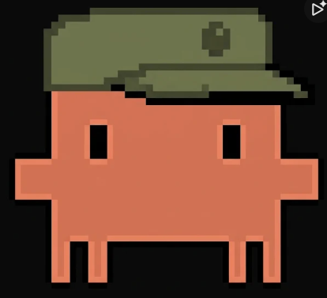

# CORVUS

[English](README.en.md) · **Español**

### Combat-Oriented Reconnaissance & Virtual Unified System

<p align="center"></p>

> **Un sistema táctico de comando multiagente para Claude Code.**

CORVUS es un sistema experimental de orquestación multiagente construido para **Claude Code**, diseñado alrededor de una estructura de comando de ciencia ficción militar.

En lugar de depender de un único agente generalista para resolver cada problema, CORVUS organiza agentes especializados en una fuerza coordinada: cada uno con un rol definido, una doctrina operativa y un área de especialidad.

El objetivo es simple:

**Reconocer. Analizar. Desplegar. Ejecutar. Verificar.**

## Tabla de contenidos

- [La doctrina](#the-doctrine)
- [Roster](#roster)
  - [COMMANDER](#commander)
  - [RAVEN](#raven)
  - [SPECTER](#specter)
  - [FORGE](#forge)
  - [VANGUARD](#vanguard)
  - [ORACLE](#oracle)
  - [SIGNAL](#signal)
  - [AEGIS](#aegis)
  - [SENTINEL](#sentinel)
  - [Selección de unidades](#unit-selection)
- [Ciclo de vida de la misión](#mission-lifecycle)
- [Filosofía multiagente](#multi-agent-philosophy)
  - [Especialización](#specialization)
  - [Delegación](#delegation)
  - [Primero el reconocimiento](#reconnaissance-first)
  - [Separación entre análisis y ejecución](#separation-of-analysis-and-execution)
  - [Verificación independiente](#independent-verification)
  - [Ejecución orientada a la misión](#mission-oriented-execution)
- [Instalación](#installation)
- [Estado del proyecto](#project-status)
- [Roadmap](#roadmap)
  - [Fase I — Estructura de comando](#phase-i--command-structure)
  - [Fase II — Despliegue](#phase-ii--deployment)
  - [Fase III — Inteligencia](#phase-iii--intelligence)
  - [Fase IV — Operaciones defensivas](#phase-iv--defensive-operations)
  - [Fase V — Infraestructura de comando](#phase-v--command-infrastructure)
- [Diseñado para](#designed-for)
- [Plugins y herramientas recomendados](#recommended-plugins--tools)
- [Terminología operativa](#operational-terminology)
- [¿Por qué CORVUS?](#why-corvus)
- [Aviso legal](#disclaimer)
- [Licencia](#license)

---

<a id="the-doctrine"></a>
## ⚔️ La doctrina

La ingeniería de software rara vez es una sola operación.

Una tarea compleja puede requerir entender un código desconocido, investigar la arquitectura existente, diseñar una solución, implementar cambios, probar el resultado y verificar que nada se haya comprometido en el camino.

CORVUS trata estas actividades como responsabilidades operativas separadas.

Un agente central de comando recibe la misión y determina qué unidades especializadas desplegar.

```text
                         COMMANDER
                    /       |       \
                   /        |        \
              RAVEN      ORACLE     SIGNAL
                   \        |        /
                    \       |       /
                         COMMANDER
                             |
                   +---------+---------+
                   |                   |
                FORGE              VANGUARD
              EXECUTOR             EXECUTOR
                   |                   |
                   +---------+---------+
                             |
                          SENTINEL
                           VERIFY
```

SPECTER y AEGIS son unidades opcionales que COMMANDER despliega directamente cuando la misión requiere depuración profunda o diseño de cara al usuario. Toda unidad reporta a COMMANDER; ninguna unidad despliega ni coordina directamente a otra.

CORVUS no intenta que cada agente sea capaz de todo.

**La especialización es la doctrina.**

---

<a id="roster"></a>
## 🦅 Roster

CORVUS opera mediante un roster de unidades autónomas especializadas.

Cada unidad tiene un rol operativo definido. Las unidades no son intercambiables: se despliegan según la naturaleza de la misión, y COMMANDER conserva la responsabilidad de coordinar sus acciones.

> **Una misión. Múltiples especialidades. Un solo mando.**

---

<a id="commander"></a>
### ☩ COMMANDER

**Alto mando · Control de misión**

COMMANDER es la autoridad central de CORVUS.

No existe para ejecutar todas las tareas. Su propósito es entender la misión, determinar qué capacidades hacen falta, desplegar las unidades adecuadas, coordinar sus operaciones y evaluar sus reportes.

**Deberes principales:**

* Interpretar el objetivo del usuario.
* Dividir objetivos complejos en tareas operativas.
* Determinar qué unidades desplegar.
* Establecer el orden de ejecución y las dependencias.
* Coordinar múltiples unidades.
* Consolidar la inteligencia y los reportes operativos.
* Evaluar el avance de la misión.
* Solicitar despliegues adicionales cuando sea necesario.
* Determinar si el objetivo de la misión se cumplió.
* Entregar el reporte final de la misión.

**Doctrina:**

> *COMMANDER no necesita saberlo todo. Necesita saber quién sí.*

---

<a id="raven"></a>
### 🦅 RAVEN

**Reconocimiento · Inteligencia del repositorio**

RAVEN es el especialista en reconocimiento de CORVUS.

Antes de que comiencen las operaciones, RAVEN mapea el terreno. Explora el código, identifica los sistemas relevantes, rastrea dependencias e informa qué existe ya.

RAVEN debe priorizar **la observación sobre la intervención**.

**Deberes principales:**

* Explorar repositorios desconocidos.
* Mapear la arquitectura del proyecto.
* Ubicar archivos y módulos relevantes.
* Identificar dependencias e integraciones.
* Analizar implementaciones existentes.
* Descubrir convenciones y patrones.
* Identificar áreas de posible impacto.
* Reportar hallazgos a COMMANDER.

**Restricciones:**

* No debe modificar el código salvo que su misión lo requiera explícitamente.
* No debe implementar soluciones cuando el objetivo real es el reconocimiento.

**Doctrina:**

> *Entiende el terreno antes de desplegar las tropas.*

---

<a id="specter"></a>
### 🌑 SPECTER

**Operaciones encubiertas · Investigación profunda**

SPECTER se especializa en problemas cuya causa está oculta bajo la superficie.

Se despliega cuando la inspección convencional no alcanza: bugs difíciles, sistemas heredados, comportamiento inesperado, interacciones complejas y problemas que exigen un rastreo profundo.

**Deberes principales:**

* Investigar bugs complejos.
* Rastrear comportamiento inesperado.
* Analizar código heredado.
* Seguir rutas de ejecución entre componentes.
* Identificar dependencias ocultas.
* Realizar análisis de causa raíz.
* Investigar fallas que resisten la depuración convencional.
* Entregar inteligencia accionable a COMMANDER.

SPECTER es una unidad de investigación, no un agente de implementación de propósito general.

**Doctrina:**

> *Observa. Infiltra. Comprende. Extrae.*

---

<a id="forge"></a>
### 🔨 FORGE

**Ingeniería · Fabricación**

FORGE es la unidad de ingeniería principal de CORVUS.

Una vez que el objetivo y la estrategia de implementación están suficientemente claros, FORGE convierte el plan operativo en software funcional.

**Deberes principales:**

* Implementar funcionalidades.
* Modificar código existente.
* Refactorizar componentes.
* Corregir bugs.
* Crear y actualizar tests.
* Implementar APIs e integraciones.
* Aplicar cambios de arquitectura.
* Producir código limpio y mantenible.

FORGE está optimizada para **objetivos de ingeniería acotados y bien definidos**.

**Doctrina:**

> *Los planes se vuelven sistemas.*

---

<a id="vanguard"></a>
### ⚔️ VANGUARD

**Asalto · Ejecución a gran escala**

VANGUARD se despliega cuando la misión excede el alcance de una operación de ingeniería acotada.

Donde FORGE hace ingeniería de precisión, VANGUARD maneja campañas más amplias que involucran múltiples sistemas, migraciones sustanciales o transformaciones a gran escala.

**Deberes principales:**

* Ejecutar campañas de implementación grandes.
* Realizar migraciones de sistemas.
* Coordinar cambios en múltiples componentes.
* Ejecutar refactors mayores.
* Manejar despliegues de funcionalidades grandes.
* Gestionar secuencias de implementación complejas.
* Mantener el impulso operativo a través de múltiples objetivos.

VANGUARD debe desplegarse cuando la misión requiere **amplitud, persistencia y ejecución coordinada**.

**Doctrina:**

> *Cuando el objetivo exige fuerza, despliega la VANGUARD.*

---

<a id="oracle"></a>
### 🔮 ORACLE

**Inteligencia estratégica · Análisis**

ORACLE es la unidad de inteligencia estratégica de CORVUS.

Se despliega cuando una misión requiere razonamiento, investigación, análisis de arquitectura o evaluación de enfoques alternativos antes de comenzar la ejecución.

ORACLE aporta inteligencia. **COMMANDER toma la decisión operativa final.**

**Deberes principales:**

* Analizar la arquitectura del sistema.
* Investigar enfoques técnicos.
* Evaluar estrategias de implementación.
* Identificar trade-offs.
* Evaluar riesgos técnicos.
* Diseñar soluciones.
* Producir planes de implementación.
* Analizar decisiones técnicas complejas.
* Recomendar el curso de acción más apropiado.

ORACLE debe favorecer **el análisis y la planificación por sobre la implementación directa**.

**Doctrina:**

> *El conocimiento precede a la acción.*

---

<a id="signal"></a>
### 📡 SIGNAL

**Documentación · Inteligencia externa**

SIGNAL es la unidad de documentación e investigación externa de CORVUS.

Se despliega cuando una misión requiere documentación oficial, referencias de API, changelogs, comparativas de librerías o información verificada fuera del código.

Cuando COMMANDER necesita un plan de implementación que depende de documentación o investigación externa, puede desplegar a SIGNAL y luego a ORACLE a partir del reporte de SIGNAL. SIGNAL reúne y verifica la inteligencia externa; ORACLE la convierte en análisis estratégico solo cuando COMMANDER decide que ese análisis hace falta.

**Deberes principales:**

* Investigar documentación oficial.
* Verificar referencias de API y comportamiento específico de cada versión.
* Revisar changelogs y notas de versión.
* Comparar librerías y frameworks.
* Comparar el comportamiento documentado con las suposiciones sobre el repositorio.
* Reportar fuentes, nivel de confianza e información contradictoria.

SIGNAL aporta información verificada. **ORACLE convierte esa información en estrategia cuando se requiere planificación.**

**Doctrina:**

> *El conocimiento verificado llega más lejos.*

---

<a id="aegis"></a>
### 🛡️ AEGIS

**Interfaz · Experiencia de usuario**

AEGIS es la unidad de interfaz y UX de CORVUS.

Se despliega siempre que una misión afecta algo que un usuario va a ver o tocar: pantallas, formularios, dashboards, componentes y flujos de interacción.

**Deberes principales:**

* Diseñar interfaces de usuario y flujos de interacción.
* Evaluar usabilidad y accesibilidad.
* Identificar patrones de UI y sistemas de diseño existentes.
* Proponer opciones concretas de layout e interacción.
* Implementar cambios de interfaz de cara al usuario cuando esté autorizado.
* Documentar el razonamiento detrás de las decisiones de interfaz.

AEGIS debe respetar los patrones establecidos del proyecto y plantear las decisiones de interfaz sin resolver antes de implementar.

**Doctrina:**

> *La interfaz es parte de la misión.*

---

<a id="sentinel"></a>
### 💀 SENTINEL

**Defensa · Verificación y control de calidad**

SENTINEL es la unidad defensiva y de verificación de CORVUS.

Su propósito es cuestionar el trabajo terminado en lugar de asumir que está correcto.

SENTINEL ofrece una evaluación independiente de si el objetivo de la misión realmente se cumplió.

**Deberes principales:**

* Ejecutar y evaluar tests.
* Detectar regresiones.
* Revisar la corrección de la implementación.
* Validar requisitos.
* Identificar problemas de seguridad.
* Inspeccionar la calidad del código.
* Cuestionar las suposiciones hechas durante la implementación.
* Identificar cambios incompletos o no deseados.
* Reportar fallas a COMMANDER.

SENTINEL es especialmente valiosa al final de misiones que implican cambios significativos de código.

**Doctrina:**

> *Nada abandona el campo de batalla sin verificar.*

---

<a id="unit-selection"></a>
### ⚔️ Selección de unidades

COMMANDER selecciona las unidades según la misión, no según un pipeline fijo:

* Desplegar RAVEN para el reconocimiento del repositorio.
* Desplegar ORACLE para arquitectura, planificación o análisis estratégico.
* Desplegar SIGNAL solo cuando hace falta documentación o investigación externa.
* Desplegar AEGIS solo cuando la misión afecta interfaces o flujos de cara al usuario.
* Elegir exactamente un ejecutor principal: FORGE para cambios acotados o VANGUARD para campañas amplias.
* Desplegar SENTINEL después para la verificación independiente.

Toda unidad reporta sus hallazgos o bloqueantes a COMMANDER. COMMANDER decide el siguiente despliegue.

---

<a id="mission-lifecycle"></a>
# 🎯 Ciclo de vida de la misión

Una operación típica de CORVUS sigue un ciclo de vida táctico:

```text
        MISSION
           |
           v
       COMMANDER
        /  |  \
       /   |   \
    UNIT  UNIT  UNIT
       \   |   /
        \  |  /
       REPORT TO COMMANDER
           |
       DECISION / DEPLOYMENT
           |
     FORGE or VANGUARD
           |
       SENTINEL VERIFY
           |
      PASS -> COMPLETE
      FAIL -> COMMANDER REDEPLOYS
```

No toda misión requiere todas las unidades.

COMMANDER determina el despliegue adecuado según el objetivo.

---

<a id="multi-agent-philosophy"></a>
# 🧠 Filosofía multiagente

CORVUS se construye sobre varios principios.

<a id="specialization"></a>
### 1. Especialización

Los agentes deben tener responsabilidades claras en lugar de intentar resolver todos los problemas.

<a id="delegation"></a>
### 2. Delegación

La capa de comando debe concentrarse en decidir **quién debe hacer el trabajo**, no necesariamente en hacerlo todo ella misma.

<a id="reconnaissance-first"></a>
### 3. Primero el reconocimiento

Los agentes deben entender un código desconocido antes de modificarlo.

<a id="separation-of-analysis-and-execution"></a>
### 4. Separación entre análisis y ejecución

Planificar e implementar son actividades distintas.

CORVUS las trata en consecuencia.

<a id="independent-verification"></a>
### 5. Verificación independiente

Un agente que escribe la solución no debe considerarse automáticamente la autoridad final sobre si la solución es correcta.

<a id="mission-oriented-execution"></a>
### 6. Ejecución orientada a la misión

Toda operación debe tener un objetivo claro, un estado operativo y una condición de finalización.

---

<a id="installation"></a>
# 📦 Instalación

CORVUS no es un paquete. Es un conjunto de definiciones de subagentes de Claude Code más un comando `/commander` que lleva la doctrina. Instalarlo en un proyecto significa copiar ambos y reiniciar Claude Code. Tus sesiones siguen siendo normales hasta que escribas `/commander <misión>`.

**Requisitos:** Claude Code instalado y el proyecto de destino abierto como directorio de trabajo. `CORVUS` más abajo es la ruta a tu clon local de este repositorio.

> **La forma más rápida:** abre Claude Code en tu proyecto y dile:
>
> *"Install CORVUS following https://github.com/KMBMarcos/corvus-claude-code/blob/main/INSTALL.md"*
>
> El agente clona el repo, copia las unidades y el comando `/commander` (tu `CLAUDE.md` no se toca) y te avisa que reinicies. Los pasos manuales de abajo hacen lo mismo.

### 1. Instalar las unidades

```bash
CORVUS=/path/to/corvus-cc
cd /path/to/your-project

mkdir -p .claude/agents .claude/missions
cp "$CORVUS"/.claude/agents/*.md .claude/agents/
```

Esto instala las ocho unidades (RAVEN, SPECTER, ORACLE, SIGNAL, AEGIS, FORGE, VANGUARD, SENTINEL). Claude Code lee el `description` de cada archivo para decidir cuándo desplegarla, y `tools` / `model` para limitar lo que puede hacer.

> Para que las unidades estén disponibles en **todos** los proyectos, cópialas a `~/.claude/agents/`. Los archivos a nivel de proyecto tienen precedencia sobre los de nivel de usuario.

### 2. Instalar el comando `/commander`

COMMANDER no es un subagente: es tu sesión principal de Claude Code, activada a demanda por un slash command que lleva su doctrina.

```bash
mkdir -p .claude/commands
cp "$CORVUS"/.claude/commands/commander.md .claude/commands/
```

El `CLAUDE.md` de tu proyecto no se modifica. La doctrina está escrita en español.

### 3. Reiniciar Claude Code

Los subagentes se cargan al iniciar la sesión. Las unidades agregadas a mitad de sesión no se detectan hasta reiniciar.

### 4. Verificar el despliegue

Ejecuta `/commander`: CORVUS te pregunta el idioma, muestra la mascota y avisa que está listo. Luego dale una misión (o ejecuta `/commander Map the structure of this project.`): COMMANDER debería desplegar a **RAVEN**. Si el comando no se encuentra o no se despliega nada, revisa que los archivos estén en `.claude/commands/` y `.claude/agents/` (no en la raíz del proyecto) y que hayas reiniciado la sesión.

### 5. Adaptar al proyecto

* **SENTINEL** descubre los comandos de test, lint y build propios del proyecto (desde `CLAUDE.md`, la configuración de CI y los manifiestos de build). Asegúrate de que esos comandos estén documentados en algún lugar donde pueda encontrarlos.
* **AEGIS** usa Bash para ejecutar Playwright CLI en los flujos de cara al usuario. En su primer despliegue te pedirá permitir Bash. Agrega el permiso en `.claude/settings.json`, por ejemplo `"permissions": { "allow": ["Bash(npx playwright:*)"] }`.
* **Strix** (pentesting) solo se ejecuta cuando el prompt de la misión indica que el entorno objetivo está autorizado para pruebas de seguridad.
* **Los registros de misión** se escriben en `.claude/missions/<fecha>-<slug>.md` para toda misión que despliegue dos o más unidades. Súbelos al repo para mantener un historial de equipo, o agrega `.claude/missions/` a `.gitignore` para mantenerlos locales.
* El primer `/commander` (no hace falta misión) pregunta si quieres las respuestas en español o inglés (se guarda en `.claude/corvus-lang`), muestra la mascota, te saluda y avisa que CORVUS está listo. Desde ahí, en esa sesión, basta con indicar tu próxima misión; no necesitas repetir el comando.
* Después, un `/commander` sin misión solo te recuerda usar `/commander <misión>`. Con una misión, CORVUS muestra la mascota y la ejecuta.
* Agrega `.claude/settings.local.json` y `.claude/corvus-lang` a `.gitignore` (la configuración personal no debe subirse).

### Actualizar y eliminar

Para actualizar, repite los pasos 1 y 2 con la versión más reciente de CORVUS. Para eliminar CORVUS, borra los ocho archivos de `.claude/agents/` y `.claude/commands/commander.md`.

---

<a id="project-status"></a>
# 🚧 Estado del proyecto

**Estado: experimental / desarrollo temprano**

CORVUS está actualmente en desarrollo activo.

El objetivo inicial es reproducir las ideas centrales de un sistema de desarrollo multiagente coordinado dentro del ecosistema de **Claude Code**, estableciendo a la vez una arquitectura táctica y una identidad operativa propias.

Se espera que la arquitectura evolucione de forma significativa a medida que avance el proyecto.

---

<a id="roadmap"></a>
# 🗺️ Roadmap

<a id="phase-i--command-structure"></a>
### Fase I — Estructura de comando

* [x] Definir la arquitectura de CORVUS
* [x] Implementar COMMANDER
* [x] Implementar las unidades especializadas
* [x] Establecer la comunicación entre agentes
* [x] Definir el ciclo de vida de la misión

<a id="phase-ii--deployment"></a>
### Fase II — Despliegue

* [x] Delegación dinámica de agentes
* [x] Ejecución paralela de agentes
* [x] Seguimiento del estado de la misión
* [x] Agregación de resultados de agentes
* [x] Recuperación ante fallos

<a id="phase-iii--intelligence"></a>
### Fase III — Inteligencia

* [x] Reconocimiento del repositorio
* [x] Planificación estratégica
* [x] Contexto compartido entre unidades
* [x] Reportes de misión persistentes
* [ ] Mejor enrutamiento de tareas

<a id="phase-iv--defensive-operations"></a>
### Fase IV — Operaciones defensivas

* [ ] Verificación automatizada
* [ ] Detección de regresiones
* [ ] Revisión de seguridad
* [ ] Auditoría independiente de implementaciones

<a id="phase-v--command-infrastructure"></a>
### Fase V — Infraestructura de comando

* [ ] Dashboard de misiones
* [ ] Logs operativos
* [ ] Telemetría de agentes
* [ ] Unidades configurables
* [ ] Estrategias de despliegue personalizadas

---

<a id="designed-for"></a>
# 🛠️ Diseñado para

CORVUS está diseñado específicamente alrededor de **Claude Code** y su flujo de desarrollo agéntico.

El proyecto busca complementar a Claude Code, no reemplazarlo.

Claude sigue siendo la inteligencia de base.

**CORVUS aporta la estructura de comando.**

---

<a id="recommended-plugins--tools"></a>
# 🔌 Plugins y herramientas recomendados

CORVUS funciona mejor cuando sus agentes tienen acceso a herramientas especializadas para validar interfaces y seguridad de aplicaciones. Instala y configura estas herramientas según el stack y los permisos del proyecto de destino.

| Herramienta | Unidades recomendadas | Apoyo a la misión |
| ----------- | --------------------- | ----------------- |
| **Playwright CLI** | AEGIS, SENTINEL | Automatización de navegador, verificación de interacciones de UI, validación visual y pruebas end-to-end. AEGIS lo usa para validar flujos de usuario; SENTINEL, para verificar de forma independiente que la interfaz funciona como se requiere. |
| **Find Skills** | COMMANDER, RAVEN, ORACLE, SIGNAL | Descubre skills reutilizables y flujos de trabajo establecidos para la misión. Ayuda a ubicar capacidades especializadas, patrones reutilizables y procedimientos documentados sin reinventar una tarea desde cero. |
| **Strix** | SENTINEL, COMMANDER | Pentesting autorizado de aplicaciones, evaluación de seguridad y hallazgos accionables sobre superficies de ataque web. SENTINEL evalúa los resultados y COMMANDER coordina la remediación cuando se encuentran riesgos. |

## Guía de despliegue de plugins

* Usa **Playwright CLI** siempre que una misión cambie pantallas, formularios, dashboards, componentes o flujos de cara al usuario.
* Ejecuta las verificaciones de Playwright durante la implementación de AEGIS y de nuevo en la fase de verificación independiente de SENTINEL.
* Usa **Find Skills** cuando el equipo necesite una capacidad reutilizable conocida, un flujo probado o un playbook de dominio ya disponible en Claude Code. La implementación de referencia está aquí: https://github.com/vercel-labs/skills/blob/main/skills%2Ffind-skills%2FSKILL.md
* Usa **Strix** para el pentesting autorizado de la aplicación, especialmente antes de un release o tras cambios en autenticación, autorización, APIs, manejo de datos u otras superficies sensibles.
* Registra versiones de las herramientas, alcance de las pruebas, entorno y hallazgos sin resolver en el reporte de la misión.
* Usa estas herramientas solo sobre aplicaciones y entornos para los que el equipo tenga autorización explícita.

---

<a id="operational-terminology"></a>
# 🎖️ Terminología operativa

CORVUS usa un vocabulario táctico en toda su interfaz y arquitectura interna.

| Término                                | Significado                                      |
| -------------------------------------- | ------------------------------------------------ |
| **Misión** (Mission)                   | Objetivo del usuario                             |
| **Comandante** (Commander)             | Coordinador estratégico                          |
| **Despliegue** (Deployment)            | Iniciar un agente                                |
| **Reconocimiento** (Reconnaissance)    | Investigación del repositorio/código             |
| **Inteligencia** (Intel)               | Información reunida por los agentes              |
| **Objetivo** (Objective)               | Tarea específica asignada a una unidad           |
| **Enfrentamiento** (Engagement)        | Ejecución activa                                 |
| **Verificación** (Verification)        | Validación independiente                         |
| **Redespliegue** (Redeployment)        | Enviar de nuevo un agente a resolver un problema |
| **Extracción** (Extraction)            | Devolver los resultados al mando                 |
| **Misión cumplida** (Mission Complete) | Objetivo verificado con éxito                    |

---

<a id="why-corvus"></a>
# 🦅 ¿Por qué CORVUS?

**CORVUS** es el nombre taxonómico del género que agrupa a cuervos y cornejas.

Representa inteligencia, observación, adaptabilidad y comportamiento coordinado: características que encajan con la filosofía detrás del sistema.

Para este proyecto, CORVUS es además un acrónimo:

> **Combat-Oriented Reconnaissance & Virtual Unified System**

Un sistema diseñado para convertir un conjunto de agentes de IA en una fuerza de desarrollo coordinada.

---

<a id="disclaimer"></a>
# ⚠️ Aviso legal

CORVUS es un proyecto de software ficticio de temática militar.

La terminología militar se usa como metáfora de los roles de ingeniería de software, la especialización de agentes, la coordinación y los flujos operativos.

CORVUS no está afiliado a ninguna organización militar.

---

<a id="license"></a>
# 📜 Licencia

Licenciado bajo la [Licencia MIT](LICENSE).

---

<p align="center">

**CORVUS**

*Reconocer. Analizar. Desplegar. Ejecutar. Verificar.*

</p>
